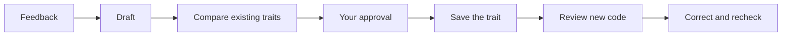

# Traits

Your coding agent learns from your feedback—and remembers.



- **Learn:** the agent turns reusable feedback into a proposed coding
  preference.
- **Remember:** it compares existing traits and asks you to approve changes.
- **Apply:** it reviews new code, corrects violations, and checks again.

Traits are readable Markdown in `.agents/traits`. They start with YAML
frontmatter describing when they apply:

```markdown
---
name: react_state_and_actions_as_atoms
id: 91f2990f-cdc0-4a1c-9a10-b0939e4de481
activation: When editing React component state.
mime: [text/typescript, text/tsx]
---

Use Effect reactivity atoms for component state.
```

`id` is a stable crypto-random UUID, independent of the descriptive snake_case
`name`. The filesystem adapter stores `<name>-<uuid>.md`; use only the UUID in
`check_traits({ traitIds: [...] })` and ignore directives. Renaming preserves
identity, and distinct IDs can share a name. Every file requires both fields in
frontmatter. `derive_trait` accepts a name and body; `Trait.make(draft)`
generates the ID before storage. `TraitStore.add(trait)` persists the full
record, `get(id)` and `rm(ids)` use UUIDs, and `update(trait)` keys by its ID.
This contract does not depend on filenames and can be implemented by a durable
object or other backend.

Checks share each source chunk across batches of up to 16 trait questions, with
a conservative 24,000-byte source-and-question budget per request. The
configured `decisionConcurrency` limits concurrent requests, not the number of
trait questions within a request. Oversized individual source/trait pairs fail
with an actionable error rather than being truncated.

`skip` is an optional string describing an independent exception within
`activation`'s scope. Omit it if it only repeats or negates `activation` or
`mime`. Checks supply applicability metadata to the decision model; these
natural-language conditions are not deterministic filesystem filters.

`activation` is an optional description of applicability. `mime` is an optional
file type or language identifier, or a list of identifiers. Additional metadata
is preserved. The SDK exposes metadata directly as `Trait.activation`,
`Trait.mime`, and `Trait.skip`, alongside `Trait.id`, `Trait.name`, and
`Trait.body`. These fields describe applicability but do not automatically
filter checks.

The MCP tools `derive_trait` and `check_traits` maintain preferences and review
code. Model assessments are guidance—not guarantees.

## Get started

Copy the setup prompt from [traits.sh](https://traits.sh), or paste this into
your coding agent inside the project:

> Set up Traits in this project using
> https://github.com/crosshatch/traits/blob/main/SETUP.md. Follow our existing
> package-manager and workspace conventions, ask me to choose providers and
> models, and preserve existing configuration.

Your agent handles dependencies, configuration, the skill, and the MCP
connection. You choose the models and supply credentials privately.

See [SETUP.md](SETUP.md) for setup instructions and troubleshooting.
