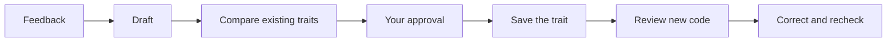

# Traits

Your coding agent learns from your feedback—and remembers.

Traits turn useful corrections into concise, reusable coding preferences. An MCP
server helps your agent maintain those preferences and review new code against
them, so you don’t have to repeat yourself.

## Start

Copy the setup prompt from [traits.sh](https://traits.sh), or paste this into
your coding agent inside the project:

> Set up Traits in this project using
> https://github.com/crosshatch/traits/blob/main/SETUP.md. Follow our existing
> package-manager and workspace conventions, ask me to choose providers and
> models, and preserve existing configuration.

Your agent handles dependencies, configuration, the skill, and the MCP
connection. You choose the models and supply credentials privately.

See [SETUP.md](SETUP.md) for the canonical agent instructions and
troubleshooting.

## From feedback to habit

The agent notices a durable preference, drafts a trait, and compares it with
what it already knows. You approve additions and changes. The saved traits guide
reviews of new code; confirmed violations are corrected and checked again.

Traits live as readable Markdown in `.agents/traits`. Two MCP tools do the work:
`derive_trait` maintains the collection; `check_traits` reviews code against it.
Model assessments are guidance—not guarantees.
