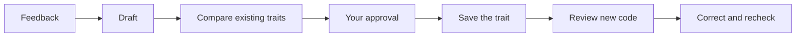

# Traits

Your coding agent learns from your feedback—and remembers.

- **Learn:** the agent turns reusable feedback into a proposed coding
  preference.
- **Remember:** it compares existing traits and asks you to approve changes.
- **Apply:** it reviews new code, corrects violations, and checks again.

Traits are readable Markdown in `.agents/traits`. The MCP tools `derive_trait`
and `check_traits` maintain preferences and review code. Model assessments are
guidance—not guarantees.

## Get started

Copy the setup prompt from [traits.sh](https://traits.sh), or paste this into
your coding agent inside the project:

> Set up Traits in this project using
> https://github.com/crosshatch/traits/blob/main/SETUP.md. Follow our existing
> package-manager and workspace conventions, ask me to choose providers and
> models, and preserve existing configuration.

Your agent handles dependencies, configuration, the skill, and the MCP
connection. You choose the models and supply credentials privately.

See [SETUP.md](SETUP.md) for setup instructions and troubleshooting.
