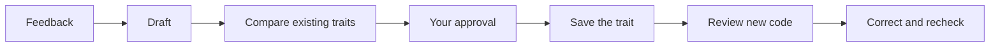

# Traits

Your coding agent learns from your feedback—and remembers.



- **Learn:** the agent turns reusable feedback into a proposed coding
  preference.
- **Remember:** it compares existing traits and asks you to approve changes.
- **Apply:** it reviews new code, corrects violations, and checks again.

Traits are readable Markdown in `.agents/traits`. They start with YAML
frontmatter describing when they apply:

```markdown
---
name: react_state_and_actions_as_atoms
id: 91f2990f-cdc0-4a1c-9a10-b0939e4de481
when: editing React component state.
mime: [text/typescript, text/tsx]
---

Use Effect reactivity atoms for component state.
```

`id` is a stable crypto-random UUID, independent of the descriptive snake_case
`name`. The filesystem adapter stores `<name>-<uuid>.md`; use only the UUID in
`check_traits({ traitIds: [...] })`. Ignore directives accept either a UUID or
an exact trait name. A UUID targets one stable identity; a name ignores every
trait with that name and must be updated if the trait is renamed. Renaming
preserves identity, and distinct IDs can share a name. Every file requires both
fields in frontmatter. `derive_trait` accepts a name and body. For new records,
generate a UUID with `Crypto`, validate it with `Trait.TraitId.make`, and
construct the complete record with the schema's `Trait.Trait.make`.
`TraitStore.add(trait)` persists the full record, `get(id)` and `rm(ids)` use
UUIDs, and `update(trait)` keys by its ID. This contract does not depend on
filenames and can be implemented by a durable object or other backend.

Checks share each source chunk across batches of up to 16 trait questions, with
a conservative 24,000-byte source-and-question budget per request. The
configured `decisionConcurrency` limits concurrent requests, not the number of
trait questions within a request. Oversized individual source/trait pairs fail
with an actionable error rather than being truncated.

`skip` is an optional string describing an independent exception within `when`'s
scope. Omit it if it only repeats or negates `when` or `mime`. Checks supply
applicability metadata to the decision model; these natural-language conditions
are not deterministic filesystem filters.

`when` is an optional description of applicability, written without a redundant
leading "When" (for example, `when: editing React state`). `mime` is an optional
file type or language identifier, or a list of identifiers. Additional metadata
is preserved. The SDK exposes metadata directly as `Trait.when`, `Trait.mime`,
and `Trait.skip`, alongside `Trait.id`, `Trait.name`, and `Trait.body`. These
fields describe applicability but do not automatically filter checks.

Related schemas share one `VariantSchema` field declaration in `Trait.ts`:
`Trait.Trait` is the complete stored record with JSON-compatible extension
fields, `Trait.TraitFrontmatter` is its fixed metadata shape without the body,
and `Trait.Generated` is the model-output shape without an ID. The generated
variant carries extension metadata as a JSON-encoded string on the wire and
decodes it to an object. These variants do not allocate IDs or change the
store's full-record insert/update contract.

The MCP tools `derive_trait` and `check_traits` maintain preferences and review
code. Model assessments are guidance—not guarantees.

## Error handling

Recoverable domain failures have distinct tags, usable with `Effect.catchTags`
or the MCP tools' JSON error payloads:

| Error                               | Useful context                                                      |
| ----------------------------------- | ------------------------------------------------------------------- |
| `MissingTraitFrontMatterError`      | Optional file `path`                                                |
| `UnterminatedTraitFrontMatterError` | Optional file `path`                                                |
| `InvalidTraitYamlError`             | Optional `path`, 1-based document `line`/`column`, original `cause` |
| `TraitFilenameMismatchError`        | Actual file `path`, `expectedFilename`                              |
| `TraitNotFoundError`                | Requested `id`                                                      |
| `TraitAlreadyExistsError`           | Existing `id`                                                       |
| `DuplicateTraitIdError`             | Conflicting `id` and file `paths`                                   |
| `TraitAssessmentTooLargeError`      | `traitId`, actual `bytes`, `maxBytes`, optional source `location`   |
| `GitFileListingError`               | Working `directory` and process `exitCode`                          |

All include a human-readable `message`, without copying the full trait or source
into the error. Pass a diagnostic path as `Trait.parse(text, path)` when parsing
file content directly; the filesystem store does this automatically. Parsing
errors live in `Trait.ts`, storage errors in `TraitStore.ts`, assessment errors
in `TraitEvaluation.ts`, and Git listing errors in `getIncludedFiles.ts`.
`Trait.ParseError` and `TraitStore.Error` group concrete errors as unions;
`TraitStore.TraitStoreError` is the tool-response schema. There is no generic
`TraitParseError` tag. Native filesystem, provider, and input-schema validation
errors retain their existing error types and diagnostics instead of being
wrapped just for consistency.

MCP failures retain `isError: true` and return the declared error's encoded tag
and context. Provider errors expose only their tag and message, not internal
request metadata.

## Get started

Copy the setup prompt from [traits.sh](https://traits.sh), or paste this into
your coding agent inside the project:

> Set up Traits in this project using
> https://github.com/crosshatch/traits/blob/main/SETUP.md. Follow our existing
> package-manager and workspace conventions, ask me to choose providers and
> models, and preserve existing configuration.

Your agent handles dependencies, configuration, the skill, and the MCP
connection. You choose the models and supply credentials privately.

See [SETUP.md](SETUP.md) for setup instructions and troubleshooting.

## Tests

Prioritize `pnpm exec vp check` and `pnpm build` for routine verification, then
run affected tests when they protect important behavior that types cannot
establish. `pnpm test` remains available for the full offline checks and suites.

`pnpm test:traits:integration` is an explicit, optional pair of focused coverage
checks using the configured real decision model—not a full end-to-end workflow
suite. Run it when changing model behavior, not after unrelated edits. It uses
normal credentials and paid API calls, and fails rather than silently skipping
missing credentials or incorrect judgments.

## Upgrade an existing collection

The bundled [`migrate_traits` skill](traits/skills/migrate_traits/SKILL.md)
guides an agent from the old random-word UUID filenames and body-only Markdown
to the current frontmatter format. It preserves UUIDs and bodies, previews
renames, updates active ignore directives and focused-check references, and
validates the collection before reconnecting the server.

Install that skill through your agent's existing skill setup, then ask:

> Use the migrate_traits skill to migrate this project's existing trait files.
> Preserve their UUIDs and bodies, and show me the migration plan first.

Loading the skill does not itself migrate files. See [SETUP.md](SETUP.md) for
installation options, including upgrading an older installation.
