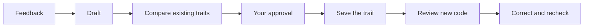

# Traits

Your coding agent learns from your feedback—and remembers.

Traits turn useful corrections into concise, reusable coding preferences. An MCP
server helps your agent maintain those preferences and review new code against
them, so you don’t have to repeat yourself.

## Start

```sh
npx traits init
```

Run inside your Git checkout. This creates `traits.ts` and installs the agent
skill at `.agents/skills/traits/SKILL.md` in the current checkout root,
preserving existing files.

Configure the model providers in `traits.ts`, supply their credentials, and
connect `npx traits` as a local MCP server in your coding agent.

## From feedback to habit

The agent notices a durable preference, drafts a trait, and compares it with
what it already knows. You approve additions and changes. The saved traits guide
reviews of new code; confirmed violations are corrected and checked again.



Traits live as readable Markdown in `.agents/traits`. Two MCP tools do the work:
`derive_trait` maintains the collection; `check_traits` reviews code against it.
Model assessments are guidance—not guarantees.
