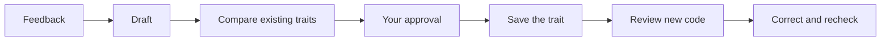

# Traits

Your coding agent learns from your feedback—and remembers.

Traits turn useful corrections into concise, reusable coding preferences. An MCP
server helps your agent maintain those preferences and review new code against
them, so you don’t have to repeat yourself.

## Start

```sh
npx traits init
```

Run inside your Git checkout. This creates `traits.ts` in the current checkout
root, preserving an existing config. It prints setup instructions but does not
install dependencies or skills.

Configure the model providers in `traits.ts`, supply their credentials, and
connect `npx traits` as a local MCP server in your coding agent.

Import the `TraitsConfig` type from `traits` and export your configuration with
`export default { ... } satisfies TraitsConfig`. The CLI's configuration layer
imports and validates the object, then provides the Traits context and both
models.

Checks refresh Git's tracked and non-ignored untracked file list on every call
and only evaluate matching files in that set. Tracked files remain eligible even
if an ignore pattern matches them. Set `excludeGitignored: false` in `traits.ts`
to disable this filter, including for files outside the checkout. Explicit
`excludes` still apply. Git failures fail the check rather than bypass
filtering.

### Install the agent skill

The Traits package ships its skill in `skills/traits/SKILL.md`. Choose one
installation method and run it from the checkout root:

- **pnpm 12.11+:** `pnpm add -D traits`, then `pnpm approve` to review and
  approve Traits' skills. pnpm links the skill from the installed package,
  keeping it aligned with package updates and removing its links when approval
  or the dependency is removed. It targets existing agent skill directories or
  the running agent's directory. If none is available, configure `skills.dirs`
  in `pnpm-workspace.yaml`; an approved skill without a target makes install
  fail.
- **Other package managers or older pnpm:** install Traits locally, then run
  `npx skills add ./node_modules/traits --skill traits`. The installer offers
  agent selection and symlink/copy options. Its normal symlink mode links agents
  to a copied snapshot, not to the installed package; rerun after updating
  Traits.
- **Without a local dependency:** run
  `npx skills add https://github.com/crosshatch/traits/tree/main/traits/skills/traits`.
  This installs the repository's current skill, which may differ from your CLI
  version. Prefer the installed package for version alignment.

For example, explicitly target shared and Claude Code skill directories with:

```yaml
# pnpm-workspace.yaml
skills:
  dirs:
    - .agents/skills
    - .claude/skills
```

`pnpm dlx` and global installs do not link skills. No installer dependency or
install hook is required in Traits. For automatic dependency-linked syncing with
other package managers, [skills-npm](https://github.com/antfu/skills-npm) is an
optional consumer-side tool; its setup adds a dependency, prepare hook, and
lockfile.

Older `traits init` versions copied the skill into `.agents/skills/traits`.
Those files are left untouched. Back up customizations before replacing an old
copy, and avoid loading it alongside the new package-managed skill.

## From feedback to habit

The agent notices a durable preference, drafts a trait, and compares it with
what it already knows. You approve additions and changes. The saved traits guide
reviews of new code; confirmed violations are corrected and checked again.



Traits live as readable Markdown in `.agents/traits`. Two MCP tools do the work:
`derive_trait` maintains the collection; `check_traits` reviews code against it.
Model assessments are guidance—not guarantees.
